# Python 콘솔 퀴즈 게임

> 코디세이 AI 올인원 과정 · 미션 2 · Python / JSON / Git & GitHub

Python의 기초 문법과 객체지향 프로그래밍을 연습하기 위해 만든 **터미널 기반 4지선다 퀴즈 게임**입니다. 기본 문제 5개로 시작하며 문제를 직접 추가할 수 있고, 퀴즈 목록과 최고 점수를 `state.json`에 저장합니다. Python 표준 라이브러리만 사용합니다.


## 퀴즈 주제 및 선정 이유

**주제: Python 기초 문법**

이번 미션에서 처음 배우는 Python의 기본 개념을 확실히 이해하기 위해 Python 기초 문법을 퀴즈 주제로 선정했습니다.

출력 함수, 자료형, 반복문, 리스트 메서드 등 직접 학습한 내용을 객관식 문제로 만들면서 Python 문법을 복습하고, 동시에 퀴즈 프로그램의 작동 원리도 이해하고자 했습니다.

또한 퀴즈 추가 기능을 검증하기 위해 대한민국의 수도와 내포신도시에 관한 문제도 직접 등록했습니다.

이 게임을 단순한 과제 결과물이 아니라 Python 학습 내용을 반복해서 확인하는 도구로 활용하는 것이 목표입니다.


## 1. 실행 환경과 시작 방법

- Python **3.10 이상** (개발·실습 환경: Python 3.14.10)
- Windows PowerShell, VS Code 터미널 또는 기타 터미널
- 별도의 외부 패키지 설치 불필요

```bash
python --version
python main.py
```

게임 메뉴는 다음과 같습니다.

```text
===== Python 퀴즈 게임 =====
1. 퀴즈 풀기
2. 퀴즈 추가
3. 퀴즈 목록
4. 점수 확인
5. 종료
메뉴를 선택하세요:
```

## 2. 주요 기능

| 메뉴 | 기능 |
|---|---|
| 1. 퀴즈 풀기 | 선택지 4개 중 정답 번호를 입력해 점수를 계산합니다. |
| 2. 퀴즈 추가 | 문제·선택지 4개·정답 번호를 입력하고 JSON에 저장합니다. |
| 3. 퀴즈 목록 | 등록된 문제 제목을 확인합니다. |
| 4. 점수 확인 | 저장된 역대 최고 점수를 출력합니다. |
| 5. 종료 | 게임을 정상 종료합니다. |

초기에는 Python 관련 **기본 문제 5개**가 들어 있습니다. 실습에서는 문제 2개를 추가하여 총 7문제와 최고 점수 7점을 저장·복원하는 과정을 검증했습니다.

## 3. 프로젝트 구성과 설계

```text
mission2-python-quiz/
├── main.py             # 프로그램 시작, 기본 문제, 메뉴 및 사용자 입력
├── quiz.py             # Quiz 클래스: 문제 출력과 정답 확인
├── game.py             # QuizGame 클래스: 진행, 점수, JSON 입출력
├── state.json          # 등록 문제와 최고 점수
├── .gitignore          # Git 추적 제외 설정
├── screenshots/        # 개발 과정에서 실제 캡처한 화면
├── evidence_logs/      # 대화에 제공된 터미널 로그를 이미지로 재구성한 참고 자료
└── README.md           # 프로젝트 설명
```

**클래스 역할 분리:** `Quiz`는 개별 퀴즈 한 문제의 정보와 채점 기능을 담당하고, `QuizGame`은 여러 문제를 관리하며 게임 진행·최고 점수·데이터 저장 및 불러오기를 담당합니다. `main.py`는 사용자에게 메뉴를 제공하고 각 기능을 연결합니다.

## 4. 데이터 저장 방식

`state.json`은 UTF-8 JSON 형식입니다. 다음은 **구조 설명용 예시**이며 실제 저장된 문제 수와 점수는 다를 수 있습니다.

```json
{
  "best_score": 3,
  "quizzes": [
    {
      "question": "대한민국의 수도는?",
      "choices": ["부산", "서울", "대전", "광주"],
      "answer": 2
    }
  ]
}
```

- 시작할 때 저장 파일을 읽고, 기본 문제와 중복되지 않는 저장 문제를 반영합니다.
- 문제를 추가하거나 최고 점수가 갱신되면 저장합니다.
- 저장 파일이 없거나 JSON 내용이 손상되거나 형식이 맞지 않을 경우, 안내 메시지를 출력하고 기본 문제로 진행하도록 방어 코드를 작성했습니다.
- **주의:** 손상된 파일로 시작한 뒤 퀴즈를 추가하거나 최고 점수를 갱신하면 `state.json`이 새로 저장될 수 있습니다. 중요한 데이터는 테스트 전에 별도로 백업해야 합니다.

## 5. 입력 오류와 예외 처리

| 상황 | 프로그램 동작 |
|---|---|
| 메뉴에서 문자 또는 빈 값 입력 | 숫자 메뉴 입력을 안내하고 다시 선택받음 |
| 정답 번호에 문자 또는 1~4 범위 밖의 값 입력 | 다시 입력받음 |
| 퀴즈 추가 시 문제·선택지가 비어 있음 | 안내 메시지를 출력하고 해당 항목을 다시 입력받음 |
| 퀴즈 추가 시 정답 번호가 유효하지 않음 | 안내 메시지를 출력하고 정답 번호를 다시 입력받음 |
| 퀴즈 풀이 중 `Ctrl+C`/EOF | 풀이를 중단하고 메인 메뉴로 복귀 |
| 퀴즈 추가 중 `Ctrl+C`/EOF | 등록을 취소하고 메인 메뉴로 복귀 |
| 메뉴 입력 중 `Ctrl+C`/EOF | 안내 메시지 후 정상 종료 |
| JSON 파일 누락·손상·구조 오류 | 안내 메시지 후 기본 문제로 실행 |
| 퀴즈가 없는 경우 | 안내 메시지를 출력하고 메뉴로 복귀 |
| JSON 파일 저장 오류 | 오류 메시지를 출력하고 비정상 종료를 방지 |

## 6. 실제 실행 및 테스트 결과

아래 항목은 개발 중 실제로 명령어를 실행하고 결과를 확인한 내용입니다.

| 검증 항목 | 관찰된 결과 |
|---|---|
| `python -m py_compile main.py game.py quiz.py` | 오류 메시지 없이 문법 검사 통과 |
| 퀴즈 목록 확인 | 기존 7문제 표시 |
| 최고 점수 확인 | `역대 최고 점수: 7점` 출력 |
| JSON 손상 실험 (`{invalid json`) | 오류로 종료하지 않고 기본 메뉴 출력 |
| 백업 JSON 복구 | 7문제와 최고 점수 7점 복원 |
| 퀴즈 풀이 입력 중단 | 메인 메뉴로 복귀 (두 차례 확인) |
| 문제·선택지 입력 중단 | 퀴즈 추가 취소 후 메뉴 복귀 |
| 퀴즈 추가 정답에 `abc` 입력 | 숫자 입력 안내 후 정답 재입력 |
| 메뉴 입력 중 중단 | 게임 정상 종료 |
| 퀴즈 풀이 정답에 `abc`, `9` 입력 | 안내 메시지 후 재입력, 정상 정답 처리 |
| 퀴즈 추가 시 빈 문제·선택지 입력 | 안내 메시지 후 해당 항목 재입력 |
| 퀴즈가 없는 상태에서 풀이·목록 실행 | 안내 메시지 출력 |
| JSON 저장 오류 실험 | `OSError` 처리 후 오류 안내, 비정상 종료 방지 |

### 실제 개발 화면 캡처

아래 이미지는 개발 과정에서 직접 올린 **실제 화면 캡처**입니다. 게임의 모든 실행 장면을 담은 것은 아닙니다.

**Python 설치 및 개발 환경**

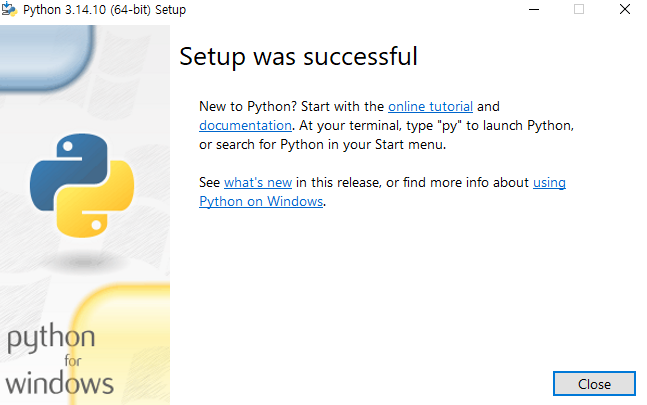

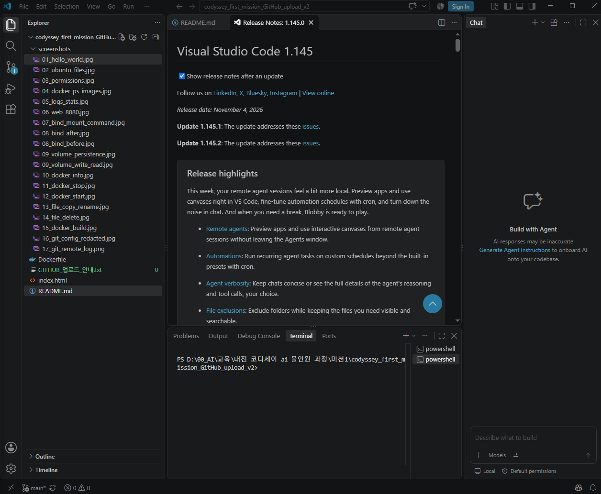

**퀴즈와 메뉴 구현**

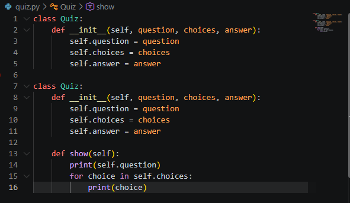

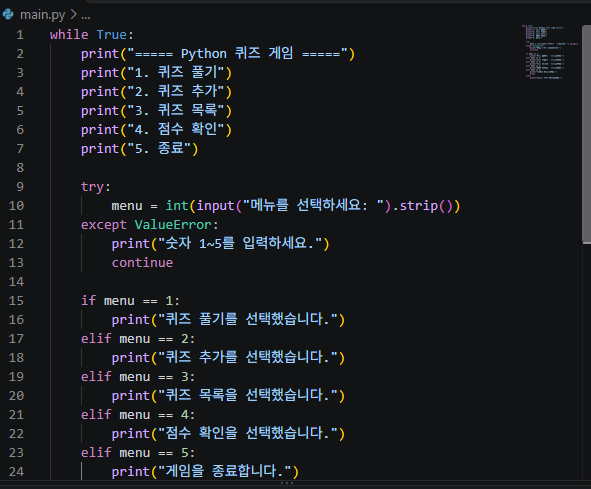

**JSON 및 예외 처리**

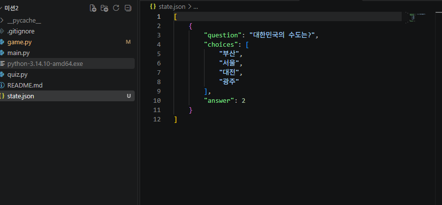

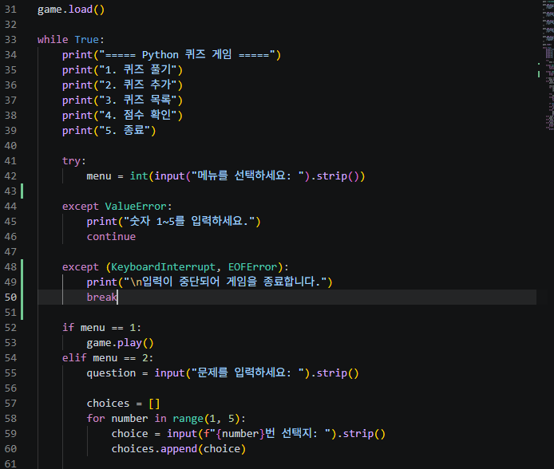


### 프로그램 실제 실행 화면

아래 이미지는 Python 퀴즈 게임을 PowerShell에서 직접 실행하고 캡처한 원본 화면입니다.

**1. 퀴즈 풀이 및 정답 확인**

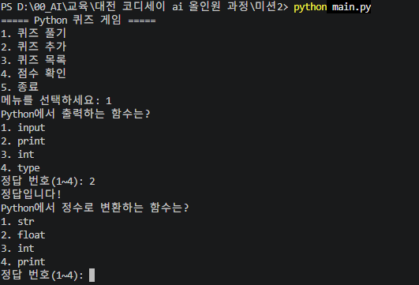

**2. 새로운 퀴즈 추가**

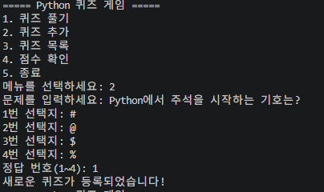

**3. 퀴즈 목록 확인 — 총 8문제**

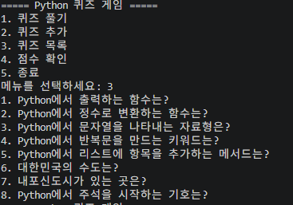

**4. 최고 점수 확인**

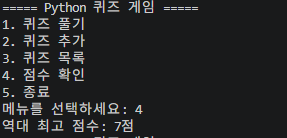

**5. Git 커밋 및 브랜치 병합 기록**

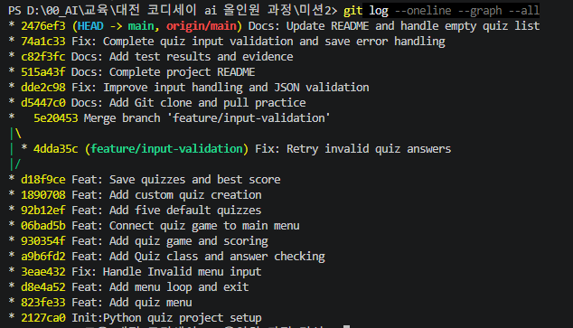


### 터미널 실행 기록을 이미지로 재구성한 자료

아래 자료는 **실제 터미널을 캡처한 스크린샷이 아닙니다.** 개발자가 대화에 붙여 넣은 터미널 출력 텍스트를 읽기 쉽게 이미지로 옮긴 **재구성 기록**입니다. 원본 실행 화면 캡처가 필수인 제출 기준에서는 대체 자료로 인정되지 않을 수 있습니다.

| 검증 내용 | 재구성 이미지 |
|---|---|
| JSON 손상 실험 | [실행 기록 보기](evidence_logs/09_json_corrupt_test.png) |
| JSON 복구 및 점수 | [실행 기록 보기](evidence_logs/10_json_recovery_and_score.png) |
| 입력 중단·잘못된 입력 | [실행 기록 보기](evidence_logs/11_quiz_cancel_test.png) |
| Git 커밋 및 브랜치 그래프 | [실행 기록 보기](evidence_logs/12_git_history_merge.png) |
| GitHub Push 및 상태 | [실행 기록 보기](evidence_logs/13_github_push_status.png) |

## 7. Git / GitHub 학습 기록

개발 과정에서 기능을 작은 단위로 나눠 커밋하고, 브랜치를 통한 개발과 병합, 복제 저장소를 이용한 Push/Pull을 직접 실습했습니다.

- **Git 커밋:** 17회 이상 (2026-11-09 기준, 추가 수정에 따라 증가)
- **최근 기능 보완 커밋:** `74a1c33`
- 기능 브랜치: `feature/input-validation`
- 기능 수정 커밋: `4dda35c` (`Fix: Retry invalid quiz answers`)
- 병합 커밋: `5e20453` (`Merge branch 'feature/input-validation'`)
- Clone 폴더 README 수정 후 Push: `d5447c0`
- JSON·입력 오류 처리: `dde2c98`
- 기존 README 정리: `515a43f`
- 원본 폴더에서 `git pull origin main` 실행 후 GitHub와 동기화, 작업 트리 Clean 확인

Git 기록을 직접 살펴보는 명령어:

```bash
git log --oneline --graph --all
git status
```

저장소: https://github.com/tajoral87-code/mission2-python-quiz

## 8. 개발 과정에서 배운 점

1. **역할 분리:** 퀴즈 한 문제와 게임 전체의 책임을 서로 다른 클래스로 나누는 방법을 배웠습니다.
2. **데이터 보존:** 프로그램을 종료해도 문제와 점수를 유지하기 위해 JSON 파일을 활용했습니다.
3. **사용자 입력 검증:** 숫자가 아닌 입력, 범위 오류, 입력 취소를 처리하며 정상 동작 외의 상황도 고려했습니다.
4. **백업과 복구:** 손상된 JSON 파일을 시험하기 전에 백업하고 원상 복원하여 데이터 안전성을 확인했습니다.
5. **버전 관리:** 브랜치 작업, 병합, Clone·Push·Pull을 직접 수행하면서 로컬과 원격 저장소의 차이를 이해했습니다.

## 9. 향후 개선 아이디어

- 문제 순서 무작위화 및 난이도 분류
- 오답 노트와 정답률 통계
- 사용자별 최고 점수 분리
- 손상된 저장 파일을 자동 백업하고 복구하는 기능 강화
- 자동화 테스트와 GitHub Actions 도입

---

**교육 과정:** 코디세이 AI 올인원 과정 — 미션2 Python 콘솔 퀴즈 게임 및 Git/GitHub 실습

**증빙 자료 구분:** `screenshots/`는 실제 제공된 캡처, `evidence_logs/`는 대화에 제공된 텍스트 로그의 재구성 이미지입니다.
